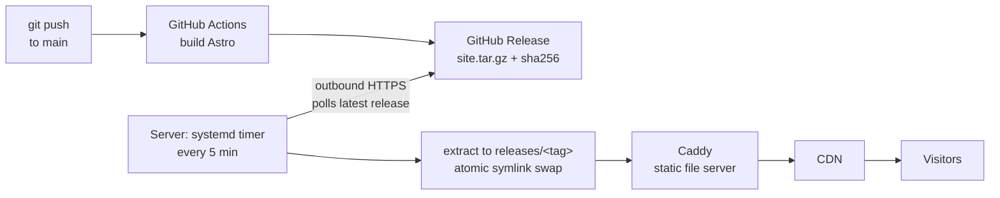

# CheapTrunk — cheaptrunk.dev

Source of [cheaptrunk.dev](https://cheaptrunk.dev), my personal site.

The site itself is a static [Astro](https://astro.build) build. The interesting part is how it gets online: a small, **pull-based GitOps pipeline** on a single self-hosted server. Every push to `main` is built in CI, published as an immutable release, and picked up by the server on its own — nobody, and no CI job, ever logs into production.

## How it works



1. **Build** — on every push to `main`, GitHub Actions installs the exact locked dependencies (`npm ci`), builds the site and packs `dist/` into `site.tar.gz` with its SHA-256 checksum.
2. **Release** — the archive is published as a GitHub Release tagged `site-<UTC timestamp>-<short sha>`, so every deployed version maps to one commit.
3. **Reconcile** — on the server, a systemd timer runs a small agent every 5 minutes. It asks the GitHub API for the latest release and compares it with what is currently live. If they match, it does nothing.
4. **Deploy** — when a new release appears, the agent downloads it, verifies the checksum, extracts it into its own directory and switches a `current` symlink to it with an atomic rename.
5. **Serve** — Caddy serves whatever `current` points to; a CDN sits in front of it.

## Design decisions

- **Pull, not push.** The server only makes outbound connections. CI holds no SSH keys or credentials for production, and no inbound port had to be opened for deployments. A compromised CI pipeline can publish a bad release, but it cannot get a shell on the server.
- **Build off the server.** No Node.js toolchain and no `node_modules` in production: the server only ever receives a finished, immutable artifact. Same artifact, same result.
- **Idempotent reconciliation.** The agent can run any number of times; it acts only when the desired state (latest release) differs from the actual state (the `current` symlink). The symlink target *is* the deployed version — there is no separate state file to drift.
- **Atomic switch.** Each release lives in its own directory. Going live is a single `rename()` of the symlink, so visitors never see a half-copied site.
- **Rollback = `git revert`.** The server always converges to the latest release, so the way back is a new commit. For emergencies the timer can be stopped and the symlink pointed at a previous release, which is still on disk.
- **Bounded retention.** The server keeps the last 3 releases; CI prunes GitHub Releases beyond the last 50.
- **Least privilege.** The workflow token is read-only by default and gets `contents: write` only in the release job. Only GitHub-authored actions are allowed. The agent runs under systemd sandboxing (read-only filesystem except the site directory). The origin only answers requests coming through the CDN.

This is the same model as Kubernetes GitOps controllers (desired state in Git, a reconcile loop on the target), scaled down to one VM and a systemd timer.

## Repository layout

```
.
├── .github/workflows/release.yml   # build → package → release → prune
├── .nvmrc                          # Node major version, shared by local dev and CI
├── public/                         # static assets copied as-is
└── src/pages/                      # Astro pages
```

## Local development

Requires Node.js (version in `.nvmrc`, managed with [nvm](https://github.com/nvm-sh/nvm)).

```bash
nvm use
npm ci
npm run dev      # http://localhost:4321, live reload
npm run build    # production build into dist/
```

Publishing is just `git push` to `main`. The change is live within roughly 10 minutes (server poll interval plus CDN cache).

## Roadmap

- Site structure and content
- Version the server-side agent and its systemd units in this repository
- Provision the whole server (containers, reverse proxy, agent, VPN) with Ansible

## License

All rights reserved. The code is public for reference; content (texts, images) belongs to the author.